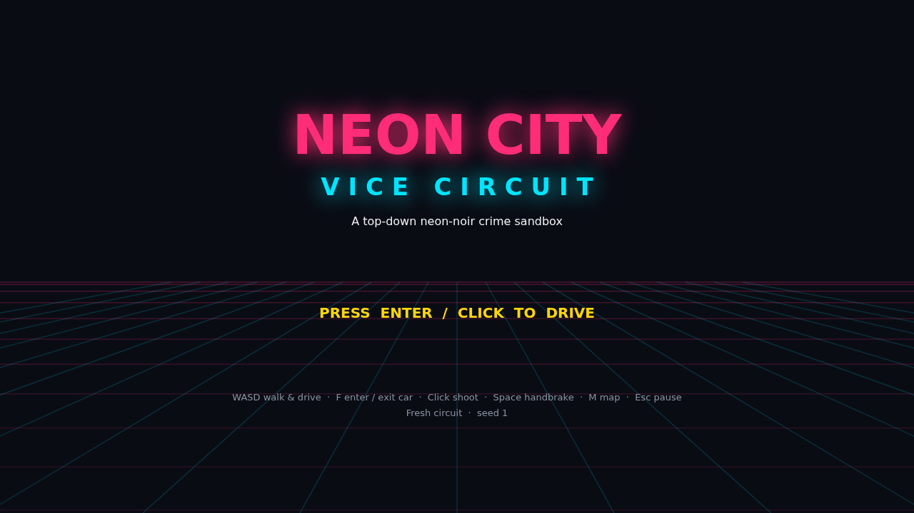
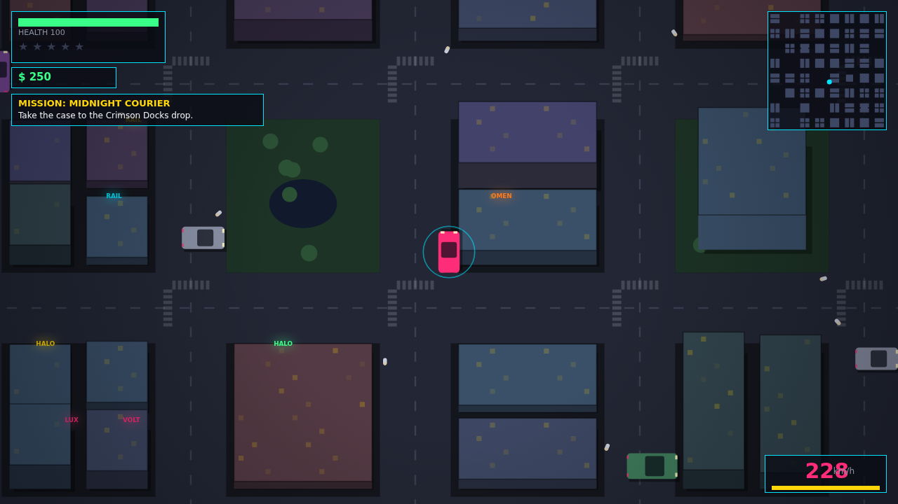
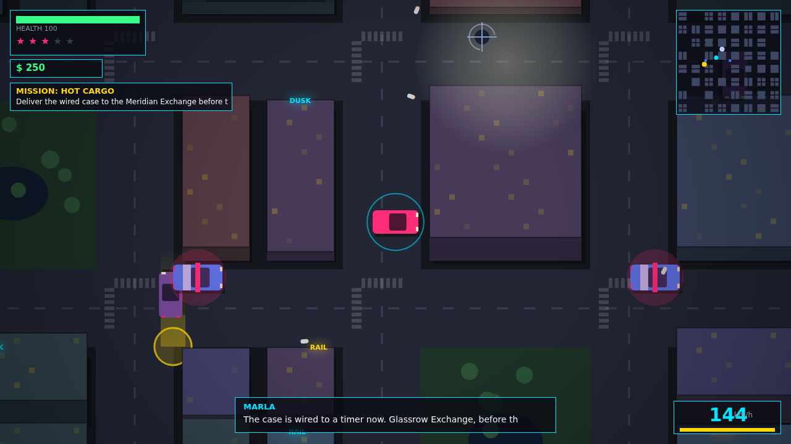

# Neon City: Vice Circuit

A top-down neon-noir crime sandbox for the browser — walk, drive, and run five
chained night missions across a procedurally generated city while outrunning a
five-star police pursuit. No frameworks, no build step, no network: vanilla ES
modules on a canvas.

[](https://make.fun/bounty/gta6-01?utm_source=github&utm_medium=readme&utm_campaign=gta6-01)
[](https://make.fun/bounty/gta6-01/leaderboard?utm_source=github&utm_medium=readme&utm_campaign=gta6-01)
[](https://make.fun/bounty/gta6-01?utm_source=github&utm_medium=readme&utm_campaign=gta6-01)

## Play

Serve the repo root statically and open `game/index.html`:

```
python3 -m http.server 8082
# http://localhost:8082/game/index.html
```

Deterministic staging for screenshots and review: append `?seed=N` to fix the
city, and `?shot=start|play|city|mission` to jump to a staged scene.

## Controls

| Input | Action |
| --- | --- |
| WASD / arrows | walk & drive |
| F | enter / exit car |
| Click | shoot (aim at cursor) |
| Space | handbrake |
| M | large map |
| Esc | pause |

## Features

- **Seeded city** — road grid, districts (Dusk, Rail, Halo, Lux, Volt, Omen),
  parks, landmarks; the same seed always rebuilds the same town.
- **Driving that feels good** — acceleration, light drift, building bounce,
  four car classes (sedan, sport, van, patrol) with distinct speed/handling.
- **Living streets** — traffic AI follows roads and turns at junctions; peds
  stroll sidewalks and scatter when shots fire or heat rises.
- **Wanted 1–5** — patrols chase at one star, roadblocks from three, a search
  helicopter with a spotlight from four; shake the heat to lose them.
- **Five chained missions** — a courier story from a simple wire drop to a
  downtown escape, with objectives, dialog, and cash rewards.
- **Combat** — cursor-aimed shooting, damage for cars, peds, police and you.
- **HUD** — minimap with mission and police blips, health, wanted stars, cash,
  objective text, and a speedometer.
- **Procedural audio** — engine pitch, gunfire, sirens and UI blips via
  WebAudio, no audio assets.
- **Autosave** — position, cash and mission progress persist in localStorage.

## Screenshots

| | |
| --- | --- |
|  |  |
|  |  |

## Development

Every gameplay system is its own module in `game/src/` (config, city, player,
car, traffic, peds, police, missions, combat, hud, render, audio, main).
`node --check` passes on all of them; the deterministic shot scenes are staged
in `main.js` (`stageShot`) and listed in `shots.json`.

## License

MIT — see [LICENSE](LICENSE).
